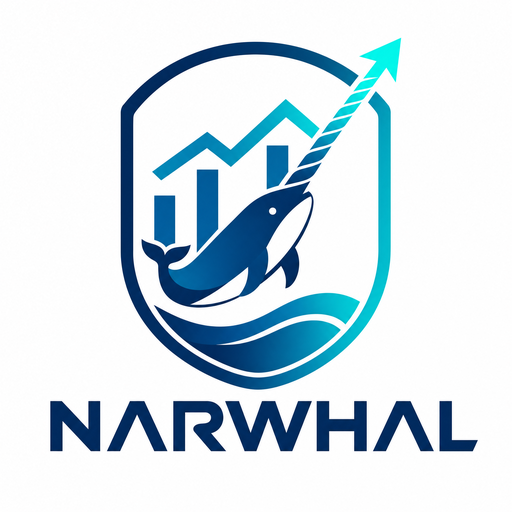
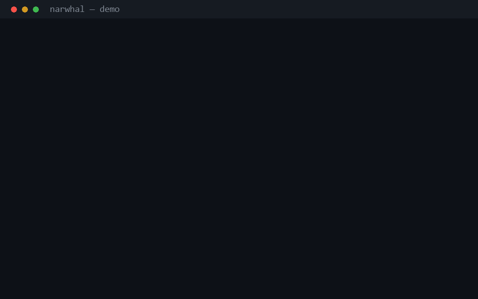

<p align="center">
  <picture>
    <source media="(prefers-color-scheme: dark)" srcset="assets/logo-dark-512.png">
    
  </picture>
</p>

<h1 align="center">Narwhal</h1>

<p align="center"><strong>Local-first SEO &amp; GEO/LLMO scanning — as an agent skill.</strong></p>

<p align="center">
  Audit any page or site for search rankings <em>and</em> AI-answer visibility
  <br>(ChatGPT · Claude · Perplexity · Google AI Overviews) — straight from your coding agent.
</p>

<p align="center">
  <a href="https://github.com/aindong/narwhal/actions/workflows/ci.yml"></a>
  
  
  
  
  
</p>

<p align="center">
  
</p>

Narwhal scans a web page or whole site for **SEO** and **GEO/LLMO** (visibility in
AI answer engines) and hands back a **prioritized, fix-first report**. It ships as
an agent skill: use it from Claude Code via
[`SKILL.md`](skills/seo-scan/SKILL.md), or from any agent that reads
[`AGENTS.md`](AGENTS.md) — Codex, Cursor, OpenCode, and friends.

No accounts, no API keys, nothing phones home. It runs on a bare Python install
and gets sharper when optional parsing/rendering libraries are present.

## Why "Narwhal"?

The narwhal is the perfect mascot for a search-and-AI-visibility tool:

- **The tusk is a sensor, not a weapon.** A narwhal's tusk is packed with millions
  of nerve endings that read tiny changes in the water around it. Narwhal the tool
  does the same for a page — it senses the subtle, easy-to-miss signals (meta,
  canonical, schema, passage citability, crawler access) that decide whether you're
  seen.
- **It navigates dark, opaque water.** Narwhals thrive in deep, ice-covered Arctic
  seas using sound, surfacing where nothing else can. Modern search and AI answer
  engines are exactly that kind of murky water — Narwhal helps you navigate it.
- **The "unicorn of the sea."** Rare and unmistakable. That's the whole goal of SEO
  and GEO: to be the distinctive result that ranks and gets *cited* by AI, not one
  of the anonymous many.
- **It dives deep.** Deep audits, not surface-level checks.

And yes, it works as a backronym too:
**N**avigate **A**I **R**ankings, **W**eb **H**ealth **A**nd **L**LM-visibility.

## What it checks

| Area | Highlights |
|---|---|
| **Technical SEO** | title/meta, headings, canonical, robots directives, viewport/mobile, hreflang, images, links, HTTP hygiene, robots.txt, sitemap |
| **Content & E-E-A-T** | thin-content detection, readability, author/date signals, Open Graph / Twitter cards |
| **Structured data** | JSON-LD + Microdata + bounded schema.org RDFa detection, required/recommended property validation, merchant checks, source-backed Google feature-retirement notes, JSON-LD generation |
| **E-commerce** | evidence-gated Product detection; Product/Offer/AggregateOffer completeness; variants; expired prices; visible-vs-schema price, currency, availability, SKU, and brand consistency |
| **GEO / LLMO** | question-based headings, citable passage structure, evidence density, direct-answer intros, `llms.txt`, and role-aware **search/retrieval robots policies**, with separate non-scoring training/data-use notes |
| **Search performance** *(opt-in)* | real Google Search Console query data: striking-distance queries, CTR laggards, decaying pages, keyword cannibalization |
| **Site structure** | click depth from the start URL, orphan-page candidates (sitemap vs crawl), internal-link equity (zero-inbound + most-linked pages) — sample-aware honesty built in |
| **Competitor gaps** | `narwhal compare <you> <rival…>`: same auditors on every page, then a gap analysis — schema types, meta strategy, depth, structure, evidence, social packaging (local-first; on-page facts only). Your first URL must load as HTML; failed competitors can be skipped, but never become "You". |
| **Content briefs** | `narwhal brief <you> <rival…>`: a data-driven writing plan — your page's real striking-distance GSC queries + competitor gaps, missing subtopics, questions to answer, schema and structure targets. No keyword APIs; without GSC it's a clearly labeled structure-only brief |

The generic page robots-meta check combines all active `name="robots"` tags,
recognizes exact `noindex`/`nofollow` names and the `none` alias, and does not
mistake directive parameter values or substrings for restrictions. Its passing
message is scoped to generic meta only; crawler-specific meta is not evaluated.
Absence of a generic meta restriction does not prove
indexability or actual search inclusion.

Final HTML-response `X-Robots-Tag` headers are checked separately for unprefixed
`noindex`/`nofollow` (including `none`). Named-crawler restrictions are non-scoring
policy observations in reports and `meta.http_robots`, not universal crawler
blocks. Raw transports retain duplicate fields; browser/legacy transports record
their field-boundary limits. Preview/date directives and real indexing are not
evaluated. Header fixes are manual hosting/CDN/middleware actions, not HTML edits.
Rendered scans fail explicitly if another main-document request starts after the
initial navigation: earlier response headers cannot safely describe a replacement
document. Scan the final destination directly. Normal HTTP redirects and
same-document History API changes remain supported.

Page reports record `meta.ai_crawler_access`: dated agent roles, primary sources,
and robots.txt root disallowance results at **`/` only**. Training/data-use choices,
nonbinding user-fetch directives and unverified roles remain visible as
non-scoring policy notes, not search failures or policy endorsements. Documented
search/retrieval restrictions retain the high finding, conditional on owner goals.
This does not test live bot/WAF access, other paths, indexing or citations. See the
[GEO reference](skills/seo-scan/references/geo-llmo.md#ai-crawler-policies--distinguish-purpose-before-recommending-access)
for the role distinctions and source scope; no policy service is called by scans.

Non-passing page findings include **Learn more** links in Markdown/HTML (and PDF
input), plus an additive `reference_url` in JSON. Known rule IDs select guide
sections; unmapped rules in built-in categories receive general category context.
Unknown categories and passing checks have no reference link. These are static
project-guide links, not proof that a heuristic finding is correct; scans do not
fetch them, and scores/rule identities are unchanged.

`compare` and `brief` retain each page's actual `rendered` boolean in JSON facts
and label its HTML source in reports: served HTML or JavaScript-rendered DOM.
Mixed modes are labeled per page; legacy missing flags stay unknown. This is
snapshot provenance, not proof that every dynamic element finished loading.

For large HTML pages, both commands accept `--max-bytes N` (default 5,000,000;
clamped to 64,000–20,000,000), as do their Python `run(..., max_bytes=N)` APIs
and MCP `compare_pages` / `content_brief` tools. One selected limit applies to
each page's primary HTML and, when rendering, its served-HTML baseline. Retry
known incomplete coverage with a sufficient budget; inputs that still exceed
the cap remain excluded rather than silently compared. This is a per-snapshot
retained HTML limit, not a total network, browser-memory or site budget.

`compare` and `brief` exclude scans explicitly marked as truncated. Partial
targets return errors (CLI exit 2); partial competitors are skipped with reasons.
Topic mode needs at least one usable page. Standalone `scan` still emits partial
findings with coverage warnings. Missing/malformed legacy flags are not inferred
to prove truncation or complete coverage.

The primary HTML budget (`scan --max-bytes`, 64KB–20MB) also applies to a rendered
DOM's retained UTF-8 snapshot. Truncation is explicit, without a broken final code
point; JS-dependence is not measured from that incomplete DOM. This is an analysis
input limit, not a cap on Chromium's DOM memory or subresource network traffic.

Rendered scans use the same selected byte budget for their served-HTML baseline.
`meta.coverage.js_comparison` records `measured` or `unverified`, the byte limit,
and an unverified reason. Missing, partial or explicitly non-HTML baselines do
not yield numeric JS-dependence statistics. A complete rendered DOM is not
relabelled as truncated when only its baseline is unavailable. Relevant
technical/GEO score comparisons with a known unverified JS measurement are
incomparable (`diff --fail-on-regression` exits 2); compare/brief skip those page
scores with diagnostics. Legacy missing receipts remain unverified, not inferred.

## Multi-agent deep audit

`/narwhal audit <site>` (in Claude Code) is more than a script — it's a
**parallel, multi-agent** audit:

1. Runs the deterministic baseline (`audit.py`) for fast, reproducible hard data
   (homepage + site crawl + sitemap, per-area subscores, broken links, duplicates).
2. **Fans out ~10 specialist subagents in parallel** — technical, content, schema,
   geo, performance, links, duplication, sitemap, sxo (+ local or e-commerce when relevant). Each
   runs the deterministic scripts as its **tools**, then adds expert reasoning and
   exact fixes for its domain.
3. **Synthesizes** one report: an SEO Health Score, executive summary, prioritized
   action plan (Critical → Low), and quick wins.

The scripts do the **measurement** (fast, zero-dep, reproducible); the agents do the
**reasoning** (business context, what heuristics miss, concrete fixes). Specialist
definitions live in [`agents/`](agents/). The other actions (`scan`, `crawl`,
`sitemap`, `llms`, `schema`) run directly for quick, deterministic output.

## Fix it, don't just report it

The audit *finds*; **`/narwhal fix <site>`** closes the loop. When the site's
source code is in your working directory, it maps each finding to the file that
owns it (title/meta, canonical, Open Graph, JSON-LD, alt text, robots.txt,
`llms.txt`…), applies minimal framework-idiomatic edits, then **re-scans and
diffs** to prove the score moved — resolved findings and the delta, from
`diff_scan.py`, not vibes.

It's honest about what a local re-scan can verify: page-level fixes check out
against a local preview; site-level signals (robots.txt, sitemap, HTTPS) are
labeled *verify after deploy*. If the source isn't in the workspace, it makes no
edits and hands you a per-finding fix plan instead. A SaaS auditor emits a PDF —
Narwhal emits a diff.

Before editing, `narwhal plan before.json --repo .` produces a versioned,
read-only remediation contract. It detects plain HTML, Next.js, Astro, Nuxt,
Hugo, or Jekyll; maps stable finding IDs to likely route/layout/static owners;
groups shared-template fixes; flags policy conflicts; and separates safe,
review-required, external, and post-deploy work. Use `--format json` for agents
or the concise Markdown default for humans. It proposes work but never edits.
See the [remediation-plan contract](docs/REMEDIATION_PLAN.md).

## Real search data (Google Search Console, opt-in)

Audits guess at priority from severity; **your own query data removes the
guessing**. `narwhal gsc <site>` pulls Search Analytics rows for your verified
property and answers "which page do I fix *first*":

- **Striking distance** — queries sitting at positions 8–20 with real
  impressions: the "push to page 1" list.
- **CTR laggards** — top-10 rankings whose CTR is far below the expected curve
  for that position: title/meta rewrite candidates.
- **Decaying pages** — clicks down ≥25% versus the previous period.
- **Keyword cannibalization** — several of your pages splitting one query
  (cross-check with the audit's near-duplicate clusters).

Add `--gsc` to `narwhal audit` and the same data lands in the report + JSON, so
`/narwhal audit` prioritizes by **real queries instead of severity guesswork**,
and `/narwhal fix` fixes the pages with actual search opportunity first.

**One-time setup (~3 minutes).** GSC has no API-key path, so this is OAuth
(read-only scope), all stdlib, credentials in your gitignored `.env`:

1. In [Google Cloud Console](https://console.cloud.google.com): enable the
   **Google Search Console API**, then *Credentials → Create credentials →
   OAuth client ID → **Desktop app***.
2. Put `GSC_CLIENT_ID=…` and `GSC_CLIENT_SECRET=…` in your `.env`.
3. Run `narwhal gsc --auth --write-env` — your browser opens Google's consent
   page; Narwhal catches the redirect on localhost and stores the refresh token.

Then just: `narwhal gsc https://your-site.com`. (Quick alternative, no client
setup: `GSC_ACCESS_TOKEN="$(gcloud auth print-access-token)"` — expires hourly.)
In a pinch for CI, mint the access token outside and pass it in; service-account
auth is deliberately not built in yet (it would require a crypto dependency).

## Quick start

```bash
# 1. (optional) install extras for better parsing + JS rendering
pip install -r skills/seo-scan/requirements.txt

# 2. audit a single page
python skills/seo-scan/scripts/scan.py https://example.com/page

# 3. audit a whole site (polite crawler: honors robots.txt, parallel, rate-limited)
python skills/seo-scan/scripts/crawl_site.py https://example.com --max-pages 25 --concurrency 4

# 4. generate valid schema.org JSON-LD
python skills/seo-scan/scripts/generate_schema.py Article \
  --field headline="How GEO works" --field author="Jane Doe"
```

Every report includes a 0–100 findings score and severity-grouped observations
with concrete fixes. Page scans record `meta.scan_scope` (`requested`, `completed`,
`not_selected` auditor groups). Focused scans label their **selected-check score**
and unchecked groups; it is not overall page health. All four groups running
does not mean site-wide or exhaustive validation. Fetch/non-HTML failures show
zero as a fail-safe, not measured health; old reports without scope do not infer
coverage from finding counts. Truncated HTML coverage stays explicit.

### Useful flags (`scan.py`)
- `--render` — render JavaScript via Playwright (for SPAs), and **measure JS
  dependence**: the served HTML is diffed against the rendered DOM — "X% of
  your content is JS-only" (with the missing headings as evidence), plus
  client-injected title/description/canonical/JSON-LD. Crawlers that don't run
  JS (most AI fetchers) never see that content. Needs
  `pip install playwright` then `python -m playwright install chromium`. If the
  browser isn't installed you get a clear one-line fix, not a stack trace; a
  render that can't run reports an honest error rather than silently falling back
  to raw HTML.
- `--format json|html|pdf [-o file]` — machine-readable JSON, a **self-contained,
  styled HTML** report (score gauge, severity-coloured finding cards — see the
  [sample](docs/samples/sample-report.html)), or **PDF** (needs a PDF engine —
  **WeasyPrint** or **Playwright/Chromium**; falls back to HTML if neither is
  present). `html`/`pdf` also work on `audit.py` for a
  shareable, stakeholder-ready deliverable — and `audit.py --vitals` adds a **Core
  Web Vitals** section (CrUX field data, or PSI lab fallback) right into that
  HTML/PDF/Markdown/JSON:
  ```bash
  python skills/seo-scan/scripts/audit.py https://example.com --vitals --format pdf -o audit.pdf
  ```
- `--only technical,content,schema,geo` — choose auditor groups; duplicates run
  once. For example, `--only schema` produces a focused structured-data report.
- `--fail-under N` — exit non-zero if the score is below `N`. Use it as a **CI
  quality gate** (also on `crawl_site.py`, where it checks the average score):
  ```bash
  python skills/seo-scan/scripts/scan.py https://example.com --fail-under 80
  ```
- `--allow-private` — permit localhost/staging targets (off by default; see below).

Expected HTTP acquisition or body-stream failures return a failed-fetch page
report with no measured area scores, including when optional `requests` is
installed. A failed stream is not analyzed as partial success. Use `--fail-under`
to make an unsuccessful scan fail a CI quality gate. HTTP error statuses and
bodies remain available for diagnostics; the `requests` path does not hide
unrelated processing errors.

An otherwise successful response with an unknown or non-text declared charset
produces a bounded failed-fetch diagnostic rather than an assumed fallback
encoding. Fix the server's `Content-Type` charset before treating that page as
measured; supported text encodings and replacement of malformed bytes retain
their existing behavior.

Expected URL syntax, DNS and host-policy failures in `scan`, `audit`, `crawl`,
`llms` and `sitemap` produce a bounded, single-line `ERROR: URL rejected: …`
diagnostic with exit code **2**; no report is created or overwritten. Python
page/site entry APIs raise `ValueError`-compatible `URLInputError` / `SSRFError`
instead. Invalid ports and malformed IPv6 are checked before transport; syntax
diagnostics do not echo parser errors containing credentials or query values.
Initial sitemap target
rejections do not produce error reports with exit 0, including direct XML inputs.
Private access remains an explicit choice for intentional local/staging scans,
never an automatic retry. This is
basic URL/host-policy validation, not a complete URL conformance validator;
unexpected programming errors are not suppressed.

Sitemap validation (also inside `audit`) records `parse_coverage` over fetched
files. Its bounded XML parser supports `urlset`/`sitemapindex` in the official
sitemap namespace, including prefixes, plus namespace-free compatibility. It
decodes XML character escaping and ignores foreign extension elements rather
than counting their locations as pages. Malformed XML, unsupported roots/entry
shapes, DTDs, or limits (128 nesting levels, 500,000 elements, 50,000 entries per
file) leave extraction unverified: all entries from that file are withheld,
valid siblings remain counted, and reports label the partial coverage. DTDs and
external entities are not loaded. Decoded input is capped at **52,428,800 bytes
per fetched file**, before UTF-8 conversion, using sized gzip reads of at most
64KiB and a one-byte overflow probe. Concatenated gzip members share that budget;
corrupt/truncated gzip and budget exhaustion withhold all text/entries/samples,
with fixed `parse_coverage.reasons` and a recorded `decoded_byte_limit`. The
ceiling follows the [sitemap protocol's uncompressed size limit](https://www.sitemaps.org/protocol.html),
but a budget note means extraction is unverified, not a complete validity verdict.
The legacy decode helper is bounded too. This is not XSD/protocol validation,
complete format support, a total Python heap/CPU bound or a transport budget.
Raw-fetch limits and existing network guards are unchanged.
The raw fetch stage retains at most **20,000,000 response-body bytes** and now
withholds the entire body on overflow rather than measuring a capped prefix.
Exact-limit success is distinguished from overflow; non-2xx responses and known
incomplete transfers also contribute no sitemap entries/samples. Failures appear
as fetch notes and a `fetch_failures` file count, not successful fetched files or
unsupported-XML findings. Mixed results label URL totals incomplete. Raw and
decoded limits describe different stages; neither is a total network/heap/CPU
budget. Redirect/private-host checks remain active. Only expected transport
failures become bounded notes; unexpected processing errors propagate after
response cleanup.
The explicit received-length check covers identity/unencoded, non-transfer-encoded
requests bodies too, including older optional dependency versions that do not
raise on a short stream. Decoded gzip/chunked sizes are not compared directly to
wire Content-Length; this is not full transport/encoding conformance validation.
`--max-sitemaps` bounds distinct file fetch attempts, including failures, recorded
as `sitemaps_attempted`; it is not a redirect-hop or whole-network request budget.
Remaining-file counts exclude already-visited and duplicate queued references.
Scan context, crawl and validator fallback discovery now share checked XML
extraction too: prefixes, gzip and XML character escaping work without treating
comments, HTML markers or bare loc tags as pages. Each discovery component has a
50-distinct-file attempt ceiling and the previous 5,000,000-byte response budget;
gzip decoded input retains the separate ceiling above. Crawl follows at most
five distinct syntax-usable child references per index and one index hop
(nested child indexes are noted, not expanded), retaining
anchor fallback and valid siblings within those limits. Already-visited entries
are skipped without retaining entire parsed-file buffers. These are component
budgets, not an aggregate audit/network/CPU/heap budget; validator traversal has
its separately selected `--max-sitemaps` budget.
Sitemap-file accounting drops literal `#fragment` values before deduplication,
child-slot selection and traversal/remaining counts, matching HTTP's fragment-free
request target. Aliases cannot repeatedly consume the same file budget or crowd
out later siblings. Query strings, encoded `%23`, path spelling and page-location
source values are not rewritten. This is not general URI canonicalization or
permission to bypass source/fetch validation.
HTTP `Content-Encoding: gzip`/`deflate` is checked separately from raw `.gz`
files: the fetch budget bounds both encoded wire bytes and decoded response
bytes. Short declared bodies, missing/corrupt compression trailers and decode
overflow contribute no XML prefix. Raw `.gz` files without HTTP encoding stay
raw for the sitemap decoder and its separate decoded-file budget. Raw fetches
advertise only supported HTTP encodings; unsolicited unsupported/stacked
encodings remain explicit fetch gaps rather than guessed complete bodies.
`sitemap_discovery` receipts record candidate scope, counts and active limits,
not whole-site URL totals. Unknown formats, incomplete fetches and limits are
explicit non-scoring notes/manual verification, not proof of missing/invalid
source. HTTP 404/410 on optional common paths remains distinct from unverified
fetches; unavailable explicitly declared roots/index children remain coverage
gaps, including when an earlier optional probe already checked that URL. If no
supported root was measured, relevant technical-score diffs and score-based
compare/brief verdicts remain unverified; focused non-technical scores and
missing legacy receipts are not guessed incomplete. Finding/scoring weights
are unchanged. The legacy pure marker/regex helpers remain compatibility hints,
not evidence used by these discovery paths.
The crawl graph's sitemap sample/count contains actual extracted candidates,
not an automatically added start URL or anchor-fallback URLs. Without verified
sitemap URL candidates the orphan check is skipped, not a sitemap-absence claim.
Unknown/legacy extraction receipts do not certify health. Planner coverage-gap
actions ask for manual verification, not rewriting an otherwise valid unsupported
format. Sampled URL success requires a successful 2xx response; gated/other
responses leave reachability unverified, and skipped sampling says so explicitly.
Positive health wording applies only to the checks performed, not unsampled URLs
or deployed indexing/search visibility.

In remediation plans, sitemap fetch failures, traversal caps, XML extraction
gaps and uncertain sampled responses become **manual verification**, not
instructions to create or rewrite a sitemap. Current `2.0` report counters must
be explicitly recorded and consistent for fetch/cap-specific context; missing,
malformed or future-schema evidence leaves notes unclassified. Notes are not
interpreted as commands or parsed for keywords. These actions have no guessed
source files and do not assume deployment is required. They ask for deployed
endpoint/status/limit checks, preserving private-host and budget boundaries.
They are excluded from shared source-edit groups, and Markdown labels their
owners deliberately unassigned for verification rather than missing.
Actual URL/lastmod problems and confirmed failing HTTP samples retain separate
source-repair advice. Gated/no-response/incomplete probes do not establish dead
URLs. Counter checks establish schema/count consistency, not authenticated
provenance or complete HTTP/XML conformance; planning remains read-only.

Crawl JSON records HTTP link-response `coverage` (successful 2xx, broken and
unverified checked targets, with no-response `request_failures` counted within
unverified) and `duplicate_coverage` (eligible SimHash fingerprints
within scanned pages). Known failed/partial pages do not enter duplicate
comparison. Zero checked links and fewer than two eligible fingerprints are
insufficient evidence, not green passes. Gated/non-success responses stay
unverified without being mislabeled dead links. Reports retain cap/omission
notes, scope clean observations to measured targets/pairs, and do not infer
coverage from legacy missing receipts. Combined audit headlines distinguish
checks not run from measured counts. These remain sampled measurements and a
near-duplicate heuristic, not exhaustive link or content health certification.
The legacy `links.broken` list retains unreachable status-0 entries for
compatibility; these are request failures, not observed broken HTTP responses.

### Track health over time (regression tracking, no database)

Narwhal stays stateless: instead of a database, save a scan as JSON and diff two
runs. Human-readable, git-friendly, and the agent can read the diff directly.

```bash
python skills/seo-scan/scripts/scan.py https://example.com --format json -o before.json
# ...after changes...
python skills/seo-scan/scripts/scan.py https://example.com --format json -o after.json
python skills/seo-scan/scripts/diff_scan.py before.json after.json
```

Diffs validate recorded auditor execution before calling findings resolved.
Use matching auditor selections that completed, and full HTML responses. Known
scope mismatches, incomplete execution, truncated responses or comparing a page
score with an audit overall score produce **Not comparable**, not a fabricated
improvement. `--fail-on-regression` exits **2** in those cases (ordinary measured
regressions exit **1**). Diagnostic diffs without the gate still exit 0.

Page scans also record `meta.scan_settings`: requested rendering, actual rendered
mode and whether image checks apply to the selected technical auditor. Known
differences block the comparison, so `--no-image-checks` cannot become a resolved
image fix and raw/rendered HTML cannot be treated as identical fix evidence.
An existing explicit boolean `rendered` field also records known actual mode.
`rule_config` is an opaque fingerprint of scoring weights, effective check
thresholds and normalized ignore categories/title patterns. A known fingerprint
change also blocks the comparison: suppressing findings or changing penalties
is not a page fix. Raw configuration values and source paths are not serialized.
Built-in rules are copied for each scan before page I/O; supplied threshold
overrides are copied on entry, and gathered overrides are copied when received.
Later caller mutations cannot change the current scan's checks or ignore policy.
This is ownership isolation, not an atomic transaction across concurrent writes:
keep inputs stable while the entry snapshot is being captured. Unsupported/custom
policies retain their behavior without a certified rule fingerprint.
Built-in rules are captured once for a crawl/audit too, so later page scans
cannot silently switch scoring or suppression when caller Config changes.
Gathered crawl threshold overrides are detached before discovery and workers;
the audit resolves its sitemap sample budget at entry. This does not freeze
remote site content or guarantee identical crawl samples between runs.
Audits retain these settings for crawled pages and check common exact URLs too;
different or unknown samples are not inferred to match.

JSON includes `comparison.status` (`comparable`, `incomparable`, `unknown`) and
reasons. Incomparable results have null `score_delta` and `regression`, empty
change lists, and `not_compared` finding counts. Legacy/malformed scope is
explicitly unverified: historical finding/score comparisons and gates remain
compatible with a visible warning, not proof of matching checks. Even matching
recorded auditor groups and known settings do not establish identical URLs,
other configuration, rule versions or site-wide crawl samples; keep those controlled when
using a diff to verify a fix.
Missing/malformed legacy settings are not guessed from findings or score changes;
the older scope-based diff behavior remains, with those settings unverified.

The diff shows the **score delta** and which findings are **new**, **resolved**,
**worsened**, or **improved** (dynamic titles like `Thin content (210 words)` are
matched across runs). Add `--fail-on-regression` as a **CI gate** — it exits
non-zero for a measured score drop/new critical-high finding or known
incomparable coverage. Commit the
JSON snapshots alongside your repo to keep a lightweight history. Works on `audit`
JSON too.

### Real Core Web Vitals (opt-in)

Everything above is local and honest about what it can measure — it will **never
fabricate** field metrics. When you want *real* Core Web Vitals (what actual Chrome
users experience), Narwhal can query Google's **Chrome UX Report (CrUX) API**. This
is the one feature that calls an external service, so it's **opt-in** and needs a
free API key.

> **CrUX vs. PageSpeed Insights.** Both surface Core Web Vitals, but they're
> different things. **PageSpeed Insights (PSI)** runs a Lighthouse *lab* test and
> historically also echoed CrUX *field* data — but as of 2026 Google is **removing
> CrUX field data from the PSI API**. So Narwhal talks to the **CrUX API directly**,
> which is the source of truth for real-user field data (LCP/INP/CLS at the 75th
> percentile). No Lighthouse lab score is fetched — our local `technical` auditor
> and the `narwhal-performance` agent already cover performance *hygiene*.

#### Get a free API key (one-time, ~2 minutes)

The CrUX API is **free** — no billing, no credit card. Quota is 150 queries/minute
per project (can't be paid to raise, but that's plenty for audits).

1. Open the [Google Cloud Console](https://console.cloud.google.com/) and
   **create or select a project** (top bar).
2. **Enable the API:** go to
   [**Chrome UX Report API**](https://console.cloud.google.com/apis/library/chromeuxreport.googleapis.com)
   and click **Enable**.
3. **Create the key:** go to
   [**APIs & Services → Credentials**](https://console.cloud.google.com/apis/credentials)
   → **Create credentials** → **API key**. Copy the key.
   *(Optional but recommended: click the key → **Restrict key** → restrict it to the
   Chrome UX Report API.)*

Full details: [Google's CrUX API guide](https://developer.chrome.com/docs/crux/api).

#### Give Narwhal the key (three ways — you don't have to pass it every time)

Narwhal resolves the key in this order, so pick whichever fits — **you only set it
once**:

1. **`--crux-key` flag** — explicit, good for one-offs or CI secret injection:
   ```bash
   narwhal vitals https://example.com/page --crux-key YOUR_KEY
   ```
2. **`CRUX_API_KEY` environment variable** — best for a permanent/global setup
   (also inherited by Claude Code and CI). Add it to your shell profile:
   ```bash
   export CRUX_API_KEY=YOUR_KEY          # macOS/Linux (~/.bashrc, ~/.zshrc)
   $env:CRUX_API_KEY = "YOUR_KEY"        # Windows PowerShell ($PROFILE for persistence)
   ```
3. **A `.env` file** — the convenient project-local option. Copy
   [`.env.example`](.env.example) to `.env`, fill in the key, and Narwhal
   auto-loads it (from the working directory or any parent):
   ```bash
   cp .env.example .env      # then edit: CRUX_API_KEY=YOUR_KEY
   narwhal vitals https://example.com
   ```
   `.env` is **gitignored**, so the secret never gets committed. (Never put the key
   in `narwhal.toml` — that file *is* meant to be committed.)

```bash
narwhal vitals https://example.com --origin --form-factor phone
```

You get **LCP, INP, CLS** (the Core Web Vitals; INP replaced FID in 2024) at the
75th percentile, each rated good / needs-improvement / poor, plus a pass/fail
verdict (and FCP/TTFB as secondary). Flags: `--origin` aggregates across the whole
site, `--form-factor phone|desktop|tablet` narrows the device, `--format json`.

CrUX only has data for pages/origins with enough real traffic — low-traffic URLs
return "no data" (try `--origin` for the site-wide aggregate). Without a key,
`narwhal vitals` prints how to get one and exits; it never guesses field numbers.

#### No CrUX data? Use lab metrics (`--lab`)

CrUX is empty for pages below its traffic floor — most pages. For those, add
**`--lab`** to run a **PageSpeed Insights (Lighthouse)** test, which works for
**any URL** regardless of traffic:

```bash
narwhal vitals https://example.com/page --lab               # mobile (default)
narwhal vitals https://example.com/page --lab --strategy desktop
```

You get an overall **performance score** plus **LCP, TBT** (the lab proxy for INP),
**CLS**, FCP, Speed Index, and TTI. **Lab data is a synthetic single run — an
estimate for catching regressions, not real-user field data**, and Narwhal labels
it that way. The PSI key is *optional* (keyless works at a low, shared quota that's
often exhausted, so a key is recommended): set `PAGESPEED_API_KEY`, or **reuse your
CrUX key** by enabling *both* the Chrome UX Report API and the PageSpeed Insights
API on the same Google Cloud project.

**Which do I want?** CrUX (default) = *real users, popular pages*. PSI `--lab` =
*synthetic, any page*. Use CrUX when it has data; fall back to `--lab` when it
doesn't.

## Install

### Claude Code — plugin (recommended, one command)

Narwhal ships as a Claude Code plugin. Add the marketplace and install it:

```text
/plugin marketplace add aindong/narwhal
/plugin install narwhal@narwhal
```

That's it — the skill and its scripts load automatically. Then use the slash
command:

```text
/narwhal audit example.com      # full multi-agent audit (folds in CrUX vitals if a key is set)
/narwhal crawl example.com      # site-wide crawl (links + duplicates)
/narwhal sitemap example.com    # validate the XML sitemap(s)
/narwhal llms example.com       # generate a starter llms.txt
/narwhal vitals example.com     # real Core Web Vitals from CrUX (needs a key — see below)
/narwhal compare you.com rival.com   # side-by-side competitor gap analysis
/narwhal brief you.com/page rival.com/page   # data-driven content brief (GSC + gaps)
/narwhal plan before.json        # read-only finding-to-source remediation plan
```

`/narwhal <action> <site>` takes actions `scan`/`audit`, `fix`, `brief`,
`compare`, `plan`, `crawl`, `sitemap`, `llms`, `schema`, `gsc`, `vitals`, `diff`, and
`render`. You can also just ask Claude naturally:

> Run an SEO and GEO audit on https://example.com

**Using `vitals` from the plugin:** the slash command runs the same CrUX lookup, so
it needs the key too — set `CRUX_API_KEY` in your shell profile (Claude Code
inherits it) or drop a `.env` in your project (see *Real Core Web Vitals* above).
Then `/narwhal vitals example.com` just works, and `/narwhal audit` automatically
includes real field data when a key is present.

**`/narwhal audit` produces a shareable, branded report file.** It doesn't just
print in the chat — after the multi-agent synthesis it writes
`narwhal-audit-report.md` and renders a **self-contained, branded HTML report**
(`narwhal-audit-report.html`) — no extra tools needed, opens anywhere. Want a
**PDF**? Add `--format pdf` (needs a rendering engine — WeasyPrint or
Playwright/Chromium — else it stays HTML), or just open the HTML and *Print → Save
as PDF*. Under the hood that's the `render` action, which turns any Markdown into a
branded report:
```bash
narwhal render narwhal-audit-report.md -o report.html      # or --format pdf -o report.pdf
```

Inline code stays escaped and literal: Markdown markers, links and HTML inside
matching backtick runs are displayed as text, not interpreted. Equal-length
runs support literal shorter backticks inside a span; unmatched runs stay text.
Spans are single-line and retain their inner spaces/tabs. This is a limited
report renderer, not a full CommonMark implementation.

Markdown HTTP(S) links format their labels without interpreting destination
characters as Markdown. Underscores and asterisks in a path/query/fragment stay
part of the URL; code examples and unsupported URL schemes do not become links.

In pipe tables, use `\|` for a literal pipe in a header or cell (also inside
inline code). Empty edge cells are retained. An odd backslash run escapes the
pipe and loses only its final escaping backslash; other backslashes stay data.
Unescaped pipes remain column separators. This does not add general Markdown
backslash escapes or alter fenced/non-table text.

Branded Markdown tables have padded cells, aligned column headers and row guides.
Wide tables scroll within their own keyboard-focusable region on screen instead
of squeezing columns or widening the page. Print/PDF input uses compact wrapping
columns rather than a clipped scroll area; native scan score tables keep their
existing presentation. Very large tables may still need manual print review.

Table separator markers set column alignment on both headers and body cells:
`:--` (or unmarked `--`) is left, `:--:` is centered, and `--:` is right.
This also keeps comparison score columns right-aligned on screen and in print.

The limited Markdown renderer preserves root fenced code (three or more matching
backticks or tildes, up to three leading spaces) as escaped literal text. Code
comments cannot become report titles, and Markdown inside a fence is not styled
as headings/lists/links. Code keeps whitespace after opening-indent removal and
CR/LF normalization; unclosed blocks extend to EOF. Screen blocks scroll for
long lines, while print/PDF input wraps them. Language labels are optional and
sanitized; there is no syntax-highlighting dependency or full CommonMark/nested-
container support.

To update later, run `/plugin marketplace update narwhal`; to remove, `/plugin
uninstall narwhal@narwhal`. (The first `narwhal` is the marketplace, the second is
the plugin.)

### Run instantly with `uvx` (no install, no PyPI)

If you have [`uv`](https://docs.astral.sh/uv/), run Narwhal straight from GitHub in
a throwaway environment — always the latest, nothing left behind:

```bash
uvx --from git+https://github.com/aindong/narwhal narwhal scan https://example.com
uvx --from git+https://github.com/aindong/narwhal narwhal crawl https://example.com --max-pages 25
uvx --from git+https://github.com/aindong/narwhal narwhal schema Article --field headline="…"
uvx --from git+https://github.com/aindong/narwhal narwhal sitemap https://example.com
uvx --from git+https://github.com/aindong/narwhal narwhal llms https://example.com
uvx --from git+https://github.com/aindong/narwhal narwhal plan before.json --repo .
```

The unified `narwhal` command includes `audit`, `scan`, `plan`, `crawl`, `schema`,
`sitemap`, `llms`, and `diff` (run any with `-h`). Prefer a stable command? Alias it:

```bash
alias narwhal='uvx --from git+https://github.com/aindong/narwhal narwhal'
narwhal scan https://example.com --fail-under 80
```

### Claude Code — manual (no plugin system)

Copy or symlink `skills/seo-scan/` into `~/.claude/skills/` (user-wide) or
`.claude/skills/` (per project), or run the installer:

```bash
bash install.sh        # macOS / Linux
```
```powershell
./install.ps1          # Windows
```

### Codex / Cursor / OpenCode / other agents

Point the agent at this repo — the root [`AGENTS.md`](AGENTS.md) documents the same
tools in the format those agents read. Then ask for an audit.

### MCP server (any MCP client)

Narwhal can also run as a [Model Context Protocol](https://modelcontextprotocol.io)
server, exposing every auditor as a native tool (`scan_page`, `crawl_site`,
`audit_site`, `validate_sitemap`, `generate_llms`, `generate_schema`,
`diff_reports`, `plan_remediation`) over stdio. The planner accepts a parsed report
object and only relative repository paths beneath the server working directory;
it is bounded and read-only. The server is a typed adapter over the same scripts — no
new analysis, so results match the CLI exactly.
Product/store evidence and `schema.ecommerce.*` findings flow through the existing
`scan_page`, `crawl_site`, and `audit_site` results; no separate network-capable
commerce tool or external merchant account is required.

```bash
pip install "narwhal-seo[mcp]"   # or: pip install "mcp>=1.12"
narwhal mcp                       # runs the stdio server
```

Register it with a client — e.g. Claude Desktop's `claude_desktop_config.json`:

```json
{
  "mcpServers": {
    "narwhal": { "command": "narwhal", "args": ["mcp"] }
  }
}
```

MCP is optional; the core toolkit stays zero-dependency.
Narwhal supports the MCP Python SDK 1.x and 2.x high-level server APIs; CI tests
both current major lines.

## Design principles

- **Local-only by default.** No external services are called. Optional API
  integrations (PageSpeed/CrUX, SERP data) are intentionally *not* on the default
  path — the scan is honest about what it can and can't measure locally.
- **Graceful degradation.** Works with only the Python standard library; uses
  `requests`, `beautifulsoup4`/`lxml`, `trafilatura`, and `playwright`
  automatically when installed.
- **SSRF-safe.** URLs that resolve to private, loopback, or link-local addresses
  are blocked unless you explicitly pass `--allow-private`.
- **Fix-first output.** Reports lead with the highest-severity, highest-leverage
  changes — not a data dump.

## Tuned against the real web (and we publish the evidence)

Narwhal's checks and specialist agents are trained in the open: we periodically
**sweep a diverse batch of real, public sites, hunt our own false positives, fix
them at the root cause, and commit the before/after scan snapshots** to
[`docs/tuning/`](docs/tuning/README.md) so you can audit the auditor.

The rule that keeps it honest: **a score never improves by loosening a check** —
only by removing findings that were *wrong*, each with a named root cause and a
regression test. In the [2026-07 round](docs/tuning/2026-07-round-1/RESULTS.md)
that meant fixing a parser bug that reported false "No H1" on most real blogs,
counting anchor text as content (link-hubs aren't "thin"), and teaching every
check **page-type awareness** (a homepage isn't judged like an article):

| Site (page type) | Before | After |
|:--|--:|--:|
| jvns.ca (personal blog) | 62 | **79** |
| news.ycombinator.com (link-hub) | 52 | **66** |
| docs.python.org (docs index) | 75 | **86** |
| theverge.com (news publisher) | 71 | **80** |

The multi-agent specialists are graded the same way — run live on real sites,
their reasoning scored, and the best behaviors encoded back into their prompts as
*Judgment rules* (classify the page type first, sample a real article, respect a
site's deliberate AI-crawler opt-outs). Full methodology and raw data:
[docs/tuning](docs/tuning/README.md).

## Reference guides

Deep-dive reasoning behind each check lives in
[`skills/seo-scan/references/`](skills/seo-scan/references/):
`technical-seo.md`, `content-eeat.md`, `schema.md`, `geo-llmo.md`.

## Configuration (optional)

Narwhal needs no config, but you can drop a **`narwhal.toml`** at your project root
to tune scoring weights, check thresholds, CLI defaults, and which findings to
ignore. It's auto-discovered; precedence is **CLI flag > `narwhal.toml` > default**.

```toml
[defaults]
fail_under = 85            # CI gate: fail below 85

[thresholds]
thin_content = 250         # our pages are intentionally concise

[ignore]
categories = ["geo"]       # hide all GEO findings
titles     = ["Open Graph"]# hide the social-preview nag
```

Full reference: **[docs/CONFIG.md](docs/CONFIG.md)** · commented template:
**[narwhal.example.toml](narwhal.example.toml)**. Use `--config PATH` or
`--no-config` to override discovery.

## Roadmap & docs

- **[docs/STATUS.md](docs/STATUS.md)** — current state & handoff snapshot.
- **[docs/ROADMAP.md](docs/ROADMAP.md)** — where Narwhal is headed (priorities,
  milestones), linked to tracking issues.
- **[CHANGELOG.md](CHANGELOG.md)** — release history.
- **[docs/](docs/README.md)** — documentation index.
- **[Issues](https://github.com/aindong/narwhal/issues)** — detailed tasks; see also
  [CONTRIBUTING.md](CONTRIBUTING.md).

## Requirements

Python 3.8+. Optional extras in
[`skills/seo-scan/requirements.txt`](skills/seo-scan/requirements.txt).

## License

MIT — see [LICENSE](LICENSE).
